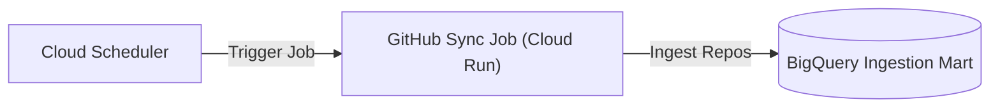

# analytics_github_sync Module

Terraform module for deploying and configuring `analytics_github_sync`.

## Architecture & Data Flow



## Golden Path Usage

```terraform
module "analytics_github_sync" {
  source = "github.com/supercargo-dev/terraform-provider-supercargo//modules/analytics_github_sync"
  container_image          = var.container_image
  github_token_secret_id   = var.github_token_secret_id
  org                      = var.org
  project_id               = var.project_id
}
```

## Configuration Variables

| Variable | Type | Default | Sensitive | Description |
| :--- | :--- | :--- | :--- | :--- |
| `container_image` | `string` | *required* | no | Container image URI for the GitHub sync job. |
| `cpu_limit` | `string` | `"1"` | no | CPU limit for the Cloud Run container. |
| `dataset` | `string` | `"supercargo_github"` | no | Target BigQuery dataset name. |
| `deletion_protection` | `bool` | `false` | no | Whether to protect the Cloud Run Job from deletion. |
| `github_token_secret_id` | `string` | *required* | no | Secret Manager secret ID containing the GitHub personal access token. |
| `hub_audience` | `string` | `""` | no | Supercargo Hub OIDC audience for authentication. |
| `hub_url` | `string` | `""` | no | Supercargo Hub service URL for runner asset health reporting. |
| `job_name` | `string` | `"analytics-github-sync"` | no | Name of the Cloud Run v2 Job. |
| `max_retries` | `number` | `1` | no | Number of retries for failed tasks. |
| `memory_limit` | `string` | `"1Gi"` | no | Memory limit for the Cloud Run container. |
| `org` | `string` | *required* | no | GitHub organization name for repository discovery and ingestion. |
| `paused` | `bool` | `false` | no | Whether the Cloud Scheduler job is paused. |
| `project_id` | `string` | *required* | no | The Google Cloud project ID where resources will be provisioned. |
| `region` | `string` | `"europe-west1"` | no | The Google Cloud region for the Cloud Run Job and Cloud Scheduler. |
| `schedule` | `string` | `"0 * * * *"` | no | Cron schedule expression for Cloud Scheduler execution. |
| `scheduler_attempt_deadline` | `string` | `"320s"` | no | The deadline for Cloud Scheduler job attempts. |
| `scheduler_job_name` | `string` | `null` | no | Name of the Cloud Scheduler job. Defaults to <job_name>-schedule if empty. |
| `scheduler_service_account_id` | `string` | `"analytics-github-sync-sched-sa"` | no | Custom account ID for the Cloud Scheduler service account. |
| `service_account_id` | `string` | `"analytics-github-sync-sa"` | no | Custom account ID for the Cloud Run Job service account. |
| `time_zone` | `string` | `"Etc/UTC"` | no | Time zone for the Cloud Scheduler job. |
| `timeout` | `string` | `"600s"` | no | Execution timeout for the Cloud Run job. |
| `topic` | `string` | `"supercargo-analytics"` | no | GitHub topic for autonomous repository discovery. |
| `vault_audience` | `string` | `""` | no | Supercargo Vault OIDC audience for authentication. |
| `vault_url` | `string` | `""` | no | Supercargo Vault service URL for PII pseudonymization and decryption. |

## Module Outputs

| Output | Sensitive | Description |
| :--- | :--- | :--- |
| `job_id` | no | The full resource ID of the provisioned Cloud Run v2 Job. |
| `job_name` | no | The name of the provisioned Cloud Run v2 Job. |
| `scheduler_job_name` | no | The name of the Cloud Scheduler job triggering ingestion. |
| `service_account_email` | no | Deterministic service account email running the ingestion Cloud Run Job. |

## Implementation
- Source Code: `modules/analytics_github_sync`
