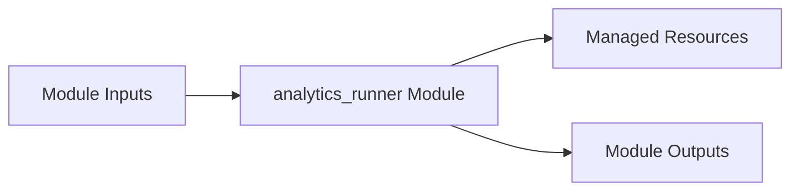

# analytics_runner Module

Terraform module for deploying and configuring `analytics_runner`.

## Architecture & Data Flow



## Golden Path Usage

```terraform
module "analytics_runner" {
  source = "github.com/supercargo-dev/terraform-provider-supercargo//modules/analytics_runner"
  container_image          = var.container_image
  project_id               = var.project_id
  region                   = var.region
}
```

## Configuration Variables

| Variable | Type | Default | Sensitive | Description |
| :--- | :--- | :--- | :--- | :--- |
| `alert_notification_channels` | `list(string)` | `[]` | no | List of Cloud Monitoring notification channel IDs for alert routing |
| `container_image` | `string` | *required* | no | Container image URI for the analytics runner job. |
| `cpu_limit` | `string` | `"2"` | no | CPU limit for the Cloud Run container. |
| `deletion_protection` | `bool` | `false` | no | Whether to protect the Cloud Run Job from deletion. |
| `dialect` | `string` | `"bigquery"` | no | SQL dialect / target warehouse (e.g. bigquery, snowflake, duckdb). |
| `enable_monitoring` | `bool` | `true` | no | Whether to enable Cloud Monitoring alerts for Analytics Runner |
| `engine` | `string` | `"dbt"` | no | Transformation engine to execute (e.g. dbt, sqlmesh). |
| `input_datasets` | `list(string)` | `[]` | no | List of BigQuery dataset IDs where runner has roles/bigquery.dataViewer permission. |
| `job_name` | `string` | `"analytics-runner"` | no | Name of the Cloud Run v2 Job. |
| `max_retries` | `number` | `1` | no | Number of retries for failed tasks. |
| `memory_limit` | `string` | `"4Gi"` | no | Memory limit for the Cloud Run container. |
| `paused` | `bool` | `false` | no | Whether the Cloud Scheduler job is paused. |
| `project_id` | `string` | *required* | no | The Google Cloud project ID where resources will be provisioned. |
| `region` | `string` | *required* | no | The Google Cloud region for the Cloud Run Job and Cloud Scheduler. |
| `schedule` | `string` | `"0 6 * * *"` | no | Cron schedule expression for Cloud Scheduler execution. |
| `scheduler_service_account_id` | `string` | `null` | no | Custom account ID for the Cloud Scheduler service account. Defaults to <job_name>-sched-sa if null or empty. |
| `service_account_id` | `string` | `null` | no | Custom account ID for the Cloud Run Job service account. Defaults to <job_name>-sa if null or empty. |
| `sla_tier` | `string` | `"TIER_1"` | no | The SLA tier (TIER_1, TIER_2, TIER_3) |
| `target_datasets` | `list(string)` | `[]` | no | List of BigQuery dataset IDs where runner has roles/bigquery.dataEditor permission. |
| `time_zone` | `string` | `"Etc/UTC"` | no | Time zone for the Cloud Scheduler job. |
| `timeout` | `string` | `"1800s"` | no | Execution timeout for the Cloud Run job. |

## Module Outputs

| Output | Sensitive | Description |
| :--- | :--- | :--- |
| `job_id` | no | Resource ID of the provisioned Cloud Run v2 Job. |
| `job_name` | no | Name of the provisioned Cloud Run v2 Job. |
| `runner_service_account_email` | no | Service account email executing the analytics transformations. |
| `scheduler_service_account_email` | no | Service account email triggering the analytics job via Cloud Scheduler. |

## Implementation
- Source Code: `modules/analytics_runner`
