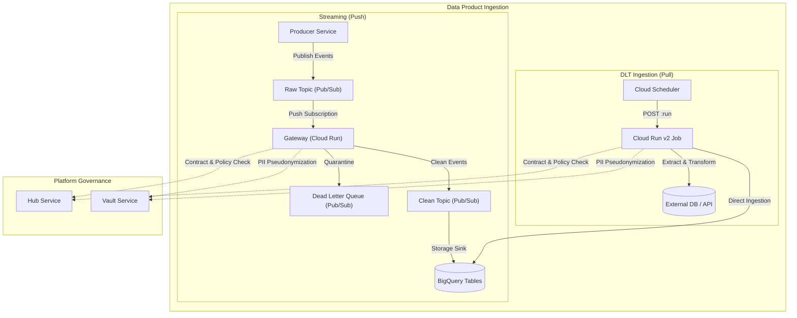

# data_product Module

Terraform module for deploying and configuring `data_product`.

## Architecture & Data Flow



## Golden Path Usage

```terraform
module "data_product" {
  source = "github.com/supercargo-dev/terraform-provider-supercargo//modules/data_product"
  hub_address              = var.hub_address
  image                    = var.image
  kms_address              = var.kms_address
  manifest_file            = var.manifest_file
  master_key_uri           = var.master_key_uri
  project_id               = var.project_id
  region                   = var.region
}
```

## Operational Backfills

Each configured DLT input port automatically computes a ready-to-run backfill command available in `dlt_backfill_commands`:

```bash
# View all available backfill commands
terraform output dlt_backfill_commands

# Execute backfill for a specific port
gcloud run jobs execute <dlt-job-name> \
  --region <region> \
  --project <project-id> \
  --args="--since=2026-01-01T00:00:00Z"
```

## Configuration Variables

| Variable | Type | Default | Sensitive | Description |
| :--- | :--- | :--- | :--- | :--- |
| `alert_email_address` | `string` | `""` | no | Email address for alerts |
| `alert_notification_channels` | `list(string)` | `[]` | no | List of existing Cloud Monitoring notification channel IDs to attach to alerts |
| `alert_pagerduty_service_key` | `string` | (sensitive) | yes | PagerDuty integration/service key for alert routing |
| `alert_slack_channel` | `string` | `""` | no | Slack channel for alerts (e.g. #team-alerts) |
| `auth_enforce` | `bool` | `true` | no | Whether to enforce OIDC authentication (Shadow Mode if false) |
| `authorized_invoker_service_accounts` | `list(string)` | `[]` | no | List of service account emails authorized to invoke the gateway service |
| `authorized_invokers` | `list(string)` | `[]` | no | List of IAM members authorized to invoke the gateway |
| `bigquery_dataset_id` | `string` | `""` | no | The BigQuery dataset ID where the table should be created |
| `bigquery_deletion_protection` | `bool` | `true` | no | Whether to enable deletion protection on BigQuery tables |
| `container_cpu` | `string` | `"1"` | no | The CPU limit for the container. |
| `container_memory` | `string` | `"512Mi"` | no | The memory limit for the container. |
| `contracts` | `map(object({ version = string schema_json = string commit_sha = string content_hash = string }))` | `{}` | no | Map of contracts to register and provision |
| `custom_audiences` | `list(string)` | `[]` | no | - |
| `dlq_alert_threshold` | `number` | `0` | no | Threshold count of undelivered messages in DLQ to trigger alert |
| `dlq_runbook_url` | `string` | `"https://docs.supercargo.dev/operations/runbooks/dlq-remediation"` | no | Runbook URL for DLQ incident remediation |
| `dlq_unacked_message_age_seconds` | `number` | `300` | no | Threshold age (in seconds) of oldest unacknowledged message in DLQ to trigger alert |
| `dlt_cpu` | `string` | `"1"` | no | The CPU allocation for DLT Cloud Run jobs |
| `dlt_deletion_protection` | `bool` | `false` | no | Whether to protect DLT BigQuery tables from accidental deletion |
| `dlt_max_retries` | `number` | `3` | no | The maximum number of retry attempts for failed DLT Cloud Run jobs |
| `dlt_memory` | `string` | `"1Gi"` | no | The memory limit for DLT Cloud Run jobs |
| `dlt_runner_image` | `string` | `"ghcr.io/supercargo-dev/supercargo-dlt-runner:latest"` | no | The container image for DLT pipeline runners |
| `dlt_runner_service_account_id` | `string` | `""` | no | Optional custom service account ID for DLT runner Cloud Run jobs |
| `dlt_scheduler_attempt_deadline` | `string` | `"320s"` | no | The attempt deadline for Cloud Scheduler jobs triggering DLT Cloud Run jobs |
| `dlt_scheduler_service_account_id` | `string` | `""` | no | Optional custom service account ID for DLT Cloud Scheduler jobs |
| `dlt_time_zone` | `string` | `"UTC"` | no | Time zone for Cloud Scheduler cron jobs |
| `dlt_timeout` | `string` | `"3600s"` | no | The maximum execution timeout for DLT Cloud Run jobs |
| `enable_dlq_alerts` | `bool` | `true` | no | Whether to enable Cloud Monitoring alert policies for DLQ |
| `force_deploy_trigger` | `string` | `"static"` | no | A value that, when changed, triggers a new Cloud Run revision (e.g. git SHA or image digest). Use 'latest' or a fixed value for idempotency. |
| `gateway_audience` | `string` | `""` | no | - |
| `hub_address` | `string` | *required* | no | The address of the Hub service |
| `hub_iap_client_id` | `string` | `""` | no | The IAP Client ID for the Hub service |
| `hub_oidc_audience` | `string` | `""` | no | The OIDC audience for the Hub service (Internal OIDC) |
| `image` | `string` | *required* | no | The container image for The Guardian service |
| `kms_address` | `string` | *required* | no | The address of the KMS (Vault) service |
| `log_level` | `string` | `"info"` | no | Log level for the service |
| `manifest_file` | `string` | *required* | no | Path to the Data Product manifest YAML/JSON file |
| `master_key_uri` | `string` | *required* | no | The URI of the Master Key in GCP KMS |
| `name_suffix` | `string` | `""` | no | Optional deterministic suffix appended to resource names for environment/branch disambiguation. Defaults to empty. |
| `project_id` | `string` | *required* | no | The GCP project ID |
| `pubsub_expiration_policy_ttl` | `string` | `"1209600s"` | no | The TTL for idle subscriptions to auto-delete. |
| `pubsub_max_delivery_attempts` | `number` | `5` | no | The maximum number of delivery attempts for a message. |
| `pubsub_maximum_backoff` | `string` | `"600s"` | no | The maximum backoff duration for retries. |
| `pubsub_message_retention_duration` | `string` | `"600s"` | no | The duration to retain messages in subscriptions. |
| `pubsub_minimum_backoff` | `string` | `"30s"` | no | The minimum backoff duration for retries. |
| `region` | `string` | *required* | no | The GCP region |
| `service_account_id` | `string` | `""` | no | Optional custom service account ID for the Gateway. If unset, defaults to 'gateway-<product_id>' with optional name_suffix. |
| `vault_iap_client_id` | `string` | `""` | no | The IAP Client ID for the Vault service |
| `vault_oidc_audience` | `string` | `""` | no | The OIDC audience for the Vault service (Internal OIDC) |

## Module Outputs

| Output | Sensitive | Description |
| :--- | :--- | :--- |
| `bigquery_table_ids` | no | A map of contract names to BigQuery table IDs |
| `clean_topic_id` | no | The ID of the Clean topic |
| `contracts` | no | Map of auto-discovered or explicitly provided contracts |
| `dlt_backfill_commands` | no | Ready-to-run gcloud commands for ad-hoc DLT historical backfills |
| `dlt_cloud_run_job_names` | no | Map of DLT input port names to their Cloud Run v2 Job names |
| `dlt_cloud_scheduler_job_ids` | no | Map of DLT input port names to their Cloud Scheduler job IDs |
| `dlt_runner_service_account_email` | no | The email of the DLT Runner Service Account (null if no DLT ports declared) |
| `dlt_scheduler_service_account_email` | no | The email of the DLT Cloud Scheduler Service Account (null if no DLT ports declared) |
| `dlq_alert_policy_age_id` | no | The ID of the Cloud Monitoring alert policy for DLQ oldest unacked message age |
| `dlq_alert_policy_undelivered_id` | no | The ID of the Cloud Monitoring alert policy for DLQ undelivered messages |
| `dlq_subscription_id` | no | The ID of the Dead Letter Queue Subscription |
| `dlq_topic_id` | no | The ID of the Dead Letter Queue topic |
| `gateway_service_name` | no | The name of the Gateway Cloud Run service |
| `gateway_url` | no | The URL of the deployed Cloud Run Gateway |
| `input_subscription_ids` | no | Map of input port names to their Pub/Sub push subscription IDs |
| `managed_input_topics` | no | Map of managed input port names to their created Pub/Sub topic IDs |
| `product_urn` | no | The URN of the registered Data Product |
| `push_invoker_service_account_email` | no | The email of the Pub/Sub Push Invoker Service Account |
| `raw_subscription_id` | no | The ID of the Raw Pub/Sub Push Subscription |
| `raw_topic_id` | no | The ID of the Raw topic |
| `service_account_email` | no | The service account email of the Gateway |
| `service_account_id` | no | The account ID of the Gateway Service Account |

## Implementation
- Source Code: `modules/data_product`
