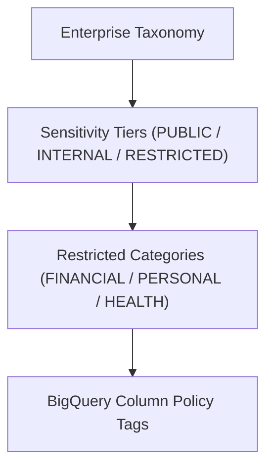

# dataplex_taxonomy Module

Terraform module for deploying and configuring `dataplex_taxonomy`.

## Architecture & Data Flow



## Golden Path Usage

```terraform
module "dataplex_taxonomy" {
  source = "github.com/supercargo-dev/terraform-provider-supercargo//modules/dataplex_taxonomy"
  project_id               = var.project_id
}
```

## Configuration Variables

| Variable | Type | Default | Sensitive | Description |
| :--- | :--- | :--- | :--- | :--- |
| `project_id` | `string` | *required* | no | The Google Cloud Project ID where the Data Catalog taxonomy and policy tags will be created. |
| `region` | `string` | `"eu"` | no | The Google Cloud region/location for the taxonomy (e.g. eu, us, europe-west1). |
| `restricted_categories` | `map(string)` | `{
    FINANCIAL = "Financial and banking records requiring segregation of duties"
    PERSONAL  = "Personal and customer identifiers governed by GDPR / privacy regulations"
    SECURITY  = "Security tokens, credentials, and cryptographic material"
  }` | no | Map of customer-defined sub-categories under the RESTRICTED sensitivity tier (e.g. { FINANCIAL = "Financial records", PERSONAL = "Personal data" }). |
| `taxonomy_description` | `string` | `"Enterprise sensitivity classification taxonomy for Supercargo data mesh governance"` | no | Description for the Data Catalog sensitivity taxonomy. |
| `taxonomy_display_name` | `string` | `"Corporate Sensitivity"` | no | Display name for the Data Catalog sensitivity taxonomy. |

## Module Outputs

| Output | Sensitive | Description |
| :--- | :--- | :--- |
| `base_policy_tags` | no | Map of base sensitivity tiers (PUBLIC, INTERNAL, CONFIDENTIAL, RESTRICTED) to their policy tag resource IDs. |
| `policy_tags` | no | Unified map of all sensitivity tiers and qualified sub-categories to their policy tag resource IDs (compatible with Supercargo Hub and BigQuery physical config). |
| `restricted_policy_tags` | no | Map of customer-defined sub-categories (e.g. RESTRICTED:FINANCIAL) to their policy tag resource IDs. |
| `taxonomy_id` | no | The unique identifier of the created Google Data Catalog taxonomy. |
| `taxonomy_name` | no | The resource name of the created Google Data Catalog taxonomy (projects/{project}/locations/{location}/taxonomies/{taxonomy}). |
| `taxonomy_urn` | no | The canonical URN of the created taxonomy in Dataplex / Data Catalog format. |

## Implementation
- Source Code: `modules/dataplex_taxonomy`
