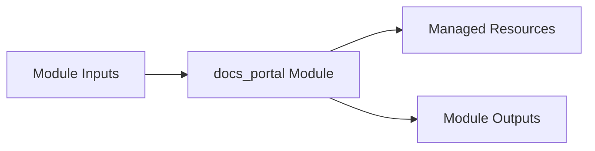

# docs_portal Module

Terraform module for deploying and configuring `docs_portal`.

## Architecture & Data Flow



## Golden Path Usage

```terraform
module "docs_portal" {
  source = "github.com/supercargo-dev/terraform-provider-supercargo//modules/docs_portal"
  domain_name              = var.domain_name
  image                    = var.image
  project_id               = var.project_id
}
```

## Configuration Variables

| Variable | Type | Default | Sensitive | Description |
| :--- | :--- | :--- | :--- | :--- |
| `domain_name` | `string` | *required* | no | The fully qualified custom domain name for the docs portal (e.g., docs.example.com) |
| `iap_client_id` | `string` | `""` | no | OAuth 2.0 Client ID for Identity-Aware Proxy (IAP) |
| `iap_client_secret` | `string` | (sensitive) | yes | OAuth 2.0 Client Secret for Identity-Aware Proxy (IAP) |
| `iap_enabled` | `bool` | `true` | no | Whether to enable Identity-Aware Proxy (IAP) on the GCLB backend service |
| `image` | `string` | *required* | no | The container image to deploy to Cloud Run |
| `licensed_domains` | `list(string)` | `[]` | no | List of corporate domains authorized to access the docs portal via IAP (e.g., ['example.com'] or ['domain:example.com']) |
| `project_id` | `string` | *required* | no | The GCP project ID where resources will be provisioned |
| `region` | `string` | `"europe-west1"` | no | The GCP region for regional resources (Cloud Run, Serverless NEG) |
| `service_name` | `string` | `"docs-portal"` | no | The name of the Cloud Run service and base naming prefix for load balancer resources |

## Module Outputs

| Output | Sensitive | Description |
| :--- | :--- | :--- |
| `backend_service_id` | no | The ID of the GCLB backend service |
| `load_balancer_ip` | no | The static global external IP address assigned to the Cloud Load Balancer |
| `service_url` | no | The authoritative HTTPS URL for the docs portal |

## Implementation
- Source Code: `modules/docs_portal`
