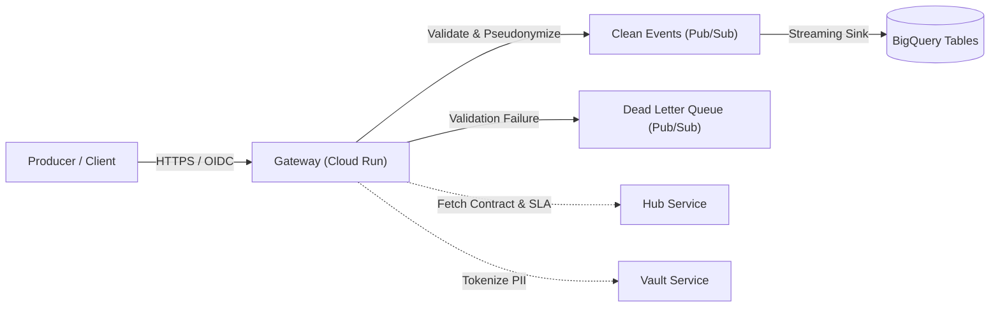

# gateway Module

Terraform module for deploying and configuring `gateway`.

## Architecture & Data Flow



## Golden Path Usage

```terraform
module "gateway" {
  source = "github.com/supercargo-dev/terraform-provider-supercargo//modules/gateway"
  hub_address              = var.hub_address
  image                    = var.image
  kms_address              = var.kms_address
  master_key_uri           = var.master_key_uri
  product_id               = var.product_id
  project_id               = var.project_id
  region                   = var.region
}
```

## Configuration Variables

| Variable | Type | Default | Sensitive | Description |
| :--- | :--- | :--- | :--- | :--- |
| `alert_email_address` | `string` | `""` | no | Email address for alerts |
| `alert_notification_channels` | `list(string)` | `[]` | no | List of existing Cloud Monitoring notification channel IDs to attach to alerts |
| `alert_pagerduty_service_key` | `string` | (sensitive) | yes | PagerDuty integration/service key for alert routing |
| `alert_slack_channel` | `string` | `""` | no | Slack channel for alerts (e.g. #team-alerts) |
| `auth_enforce` | `bool` | `true` | no | Whether to enforce OIDC authentication (Shadow Mode if false) |
| `authorized_invoker_service_accounts` | `list(string)` | `[]` | no | List of service account emails authorized to invoke the gateway service |
| `authorized_invokers` | `list(string)` | `[]` | no | List of IAM members authorized to invoke the gateway |
| `bigquery_dataset_id` | `string` | `""` | no | The BigQuery dataset ID where the table should be created |
| `bigquery_deletion_protection` | `bool` | `true` | no | Whether to enable deletion protection on BigQuery tables |
| `bigquery_subscription_filter` | `string` | `""` | no | Pub/Sub filter expression for the BigQuery subscription |
| `bigquery_target_table` | `string` | `""` | no | The BigQuery table to stream clean data into (optional) |
| `bigquery_use_table_schema` | `bool` | `true` | no | Whether to use the BigQuery table schema for the subscription |
| `container_cpu` | `string` | `"1"` | no | The CPU limit for the container. |
| `container_memory` | `string` | `"512Mi"` | no | The memory limit for the container. |
| `contracts` | `map(object({ id = string schema = string }))` | `{}` | no | A map of contract configurations for strongly typed BigQuery tables |
| `custom_audiences` | `list(string)` | `[]` | no | List of custom audiences to accept for OIDC |
| `dlq_alert_threshold` | `number` | `0` | no | Threshold count of undelivered messages in DLQ to trigger alert |
| `dlq_runbook_url` | `string` | `"https://docs.supercargo.dev/operations/runbooks/dlq-remediation"` | no | Runbook URL for DLQ incident remediation |
| `dlq_unacked_message_age_seconds` | `number` | `300` | no | Threshold age (in seconds) of oldest unacknowledged message in DLQ to trigger alert |
| `enable_dlq_alerts` | `bool` | `true` | no | Whether to enable Cloud Monitoring alert policies for DLQ |
| `force_deploy_trigger` | `string` | `"static"` | no | A value that, when changed, triggers a new Cloud Run revision (e.g. git SHA or image digest). Use 'latest' or a fixed value for idempotency. |
| `gateway_audience` | `string` | `""` | no | The expected audience for OIDC tokens (e.g. the service URL) |
| `hub_address` | `string` | *required* | no | The address of the Hub service |
| `hub_iap_client_id` | `string` | `""` | no | The IAP Client ID for the Hub service |
| `hub_oidc_audience` | `string` | `""` | no | The OIDC audience for the Hub service (Internal OIDC) |
| `image` | `string` | *required* | no | The container image for The Guardian service |
| `ingress_type` | `string` | `"INGRESS_TRAFFIC_ALL"` | no | The type of ingress traffic allowed (INGRESS_TRAFFIC_ALL or INGRESS_TRAFFIC_INTERNAL_ONLY or INGRESS_TRAFFIC_INTERNAL_AND_GCLB) |
| `kms_address` | `string` | *required* | no | The address of the KMS (Vault) service |
| `log_level` | `string` | `"info"` | no | Log level for the service |
| `master_key_uri` | `string` | *required* | no | The URI of the Master Key in GCP KMS |
| `name_suffix` | `string` | `""` | no | Optional deterministic suffix appended to resource names for environment/branch disambiguation. Defaults to empty. |
| `product_id` | `string` | *required* | no | The ID of the Data Product (used for naming resources) |
| `project_id` | `string` | *required* | no | The GCP project ID |
| `pubsub_expiration_policy_ttl` | `string` | `"1209600s"` | no | The TTL for idle subscriptions to auto-delete. |
| `pubsub_max_delivery_attempts` | `number` | `5` | no | The maximum number of delivery attempts for a message. |
| `pubsub_maximum_backoff` | `string` | `"600s"` | no | The maximum backoff duration for retries. |
| `pubsub_message_retention_duration` | `string` | `"600s"` | no | The duration to retain messages in subscriptions. |
| `pubsub_minimum_backoff` | `string` | `"30s"` | no | The minimum backoff duration for retries. |
| `pubsub_push_path` | `string` | `"/pubsub/push/"` | no | The URL path for Pub/Sub push requests |
| `region` | `string` | *required* | no | The GCP region |
| `service_account_id` | `string` | `""` | no | Optional custom service account ID for the Gateway. If unset, defaults to 'gateway-<product_id>' with optional name_suffix. |
| `vault_iap_client_id` | `string` | `""` | no | The IAP Client ID for the Vault service |
| `vault_oidc_audience` | `string` | `""` | no | The OIDC audience for the Vault service (Internal OIDC) |

## Module Outputs

| Output | Sensitive | Description |
| :--- | :--- | :--- |
| `bigquery_table_ids` | no | A map of contract names to BigQuery table IDs |
| `clean_topic_id` | no | The ID of the Clean topic |
| `dlq_alert_policy_age_id` | no | The ID of the DLQ message age alert policy |
| `dlq_alert_policy_undelivered_id` | no | The ID of the DLQ undelivered messages alert policy |
| `dlq_subscription_id` | no | The ID of the Dead Letter Queue subscription |
| `dlq_topic_id` | no | The ID of the Dead Letter Queue topic |
| `push_invoker_service_account_email` | no | The email of the Pub/Sub Push Invoker Service Account (plan-time deterministic) |
| `raw_subscription_id` | no | The ID of the Raw push subscription |
| `raw_topic_id` | no | The ID of the Raw topic |
| `service_account_email` | no | The email of the Gateway Service Account (plan-time deterministic) |
| `service_account_id` | no | The account ID of the Gateway Service Account |
| `service_name` | no | The name of the Gateway service |
| `service_url` | no | The URL of the Gateway service |

## Implementation
- Source Code: `modules/gateway`
