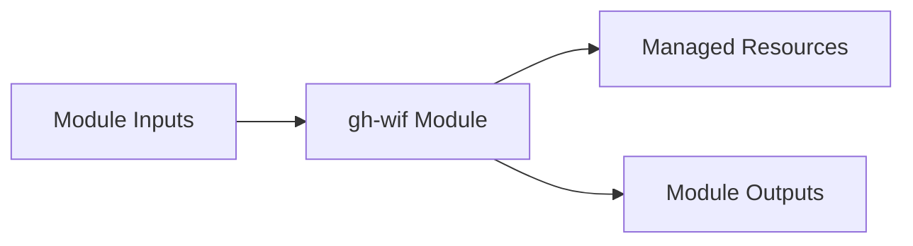

# gh-wif Module

Terraform module for deploying and configuring `gh-wif`.

## Architecture & Data Flow



## Golden Path Usage

```terraform
module "gh-wif" {
  source = "github.com/supercargo-dev/terraform-provider-supercargo//modules/gh-wif"
  project_id               = var.project_id
  repository               = var.repository
}
```

## Configuration Variables

| Variable | Type | Default | Sensitive | Description |
| :--- | :--- | :--- | :--- | :--- |
| `pool_display_name` | `string` | `"GitHub Workload Identity Pool"` | no | Display name for the pool |
| `pool_id` | `string` | `"github-pool"` | no | The ID of the Workload Identity Pool |
| `project_id` | `string` | *required* | no | The GCP Project ID where the WIF pool will be created |
| `provider_id` | `string` | `"github-provider"` | no | The ID of the Workload Identity Pool Provider |
| `repository` | `string` | *required* | no | The GitHub repository in 'owner/repo' format |
| `service_account_id` | `string` | `"github-actions-wif"` | no | The account ID for the service account |

## Module Outputs

| Output | Sensitive | Description |
| :--- | :--- | :--- |
| `provider_name` | no | The full identifier of the Workload Identity Pool Provider |
| `service_account_email` | no | The email of the Service Account for GitHub Actions |

## Implementation
- Source Code: `modules/gh-wif`
