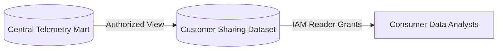

# global_telemetry_share Module

Terraform module for deploying and configuring `global_telemetry_share`.

## Architecture & Data Flow



## Golden Path Usage

```terraform
module "global_telemetry_share" {
  source = "github.com/supercargo-dev/terraform-provider-supercargo//modules/global_telemetry_share"
  project_id               = var.project_id
}
```

## Configuration Variables

| Variable | Type | Default | Sensitive | Description |
| :--- | :--- | :--- | :--- | :--- |
| `data_exchange_id` | `string` | `""` | no | The ID of the Analytics Hub Data Exchange (required if enable_analytics_hub_listing is true) |
| `dataset_id` | `string` | `"supercargo_global_telemetry"` | no | The ID of the shared BigQuery dataset |
| `enable_analytics_hub_listing` | `bool` | `false` | no | Whether to publish the shared dataset to BigQuery Analytics Hub |
| `enable_global_sdlc_share` | `bool` | `true` | no | Feature flag to enable or disable global SDLC efficiency sharing resources |
| `enable_global_telemetry_share` | `bool` | `true` | no | Feature flag to enable or disable global telemetry sharing resources |
| `enable_peer_benchmark_subscription` | `bool` | `false` | no | Whether to subscribe to the fleet-wide anonymous peer benchmarks via Analytics Hub |
| `github_dataset_id` | `string` | `"supercargo_github"` | no | The ID of the GitHub dataset containing pull requests and issues |
| `internal_dataset_id` | `string` | `"supercargo_intelligence_internal"` | no | The ID of the internal intelligence dataset containing the authorized view source tables |
| `location` | `string` | `"EU"` | no | The GCP region/location for BigQuery resources |
| `peer_benchmark_data_exchange_id` | `string` | `""` | no | The Analytics Hub Data Exchange ID for peer benchmarks (defaults to data_exchange_id if empty) |
| `peer_benchmark_dataset_id` | `string` | `"supercargo_peer_benchmarks"` | no | The destination dataset ID for the reciprocal peer benchmark subscription |
| `peer_benchmark_listing_id` | `string` | `""` | no | The Analytics Hub Listing ID for peer benchmarks |
| `project_id` | `string` | *required* | no | The GCP project ID where the shared BigQuery dataset will be created |
| `supercargo_reader_principal` | `string` | `"serviceAccount:telemetry-reader@supercargo-global.iam.gserviceaccount.com"` | no | IAM principal for the central Supercargo telemetry reader service account |

## Module Outputs

| Output | Sensitive | Description |
| :--- | :--- | :--- |
| `analytics_hub_listing_id` | no | Resource ID of the Analytics Hub listing |
| `authorized_view_access_id` | no | Resource ID of the Authorized View grant on the internal dataset |
| `authorized_view_github_access_id` | no | Resource ID of the Authorized View grant on the GitHub dataset |
| `authorized_view_github_sdlc_access_id` | no | Resource ID of the Authorized View grant for SDLC efficiency metrics on the GitHub dataset |
| `authorized_view_sdlc_access_id` | no | Resource ID of the Authorized View grant for SDLC efficiency metrics on the internal dataset |
| `dataset_access_id` | no | Resource ID of the reader dataset access grant |
| `dataset_id` | no | The ID of the shared BigQuery dataset |
| `peer_benchmark_subscription_id` | no | Resource ID of the reciprocal peer benchmark Analytics Hub subscription |
| `peer_benchmarks_enabled` | no | Whether peer benchmark subscription is active |
| `sdlc_analytics_hub_listing_id` | no | Resource ID of the Analytics Hub listing for SDLC efficiency metrics |
| `sdlc_sharing_enabled` | no | Whether global SDLC efficiency sharing is active |
| `sharing_enabled` | no | Whether global telemetry sharing is active |

## Implementation
- Source Code: `modules/global_telemetry_share`
