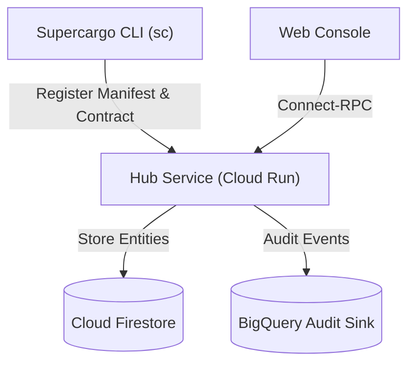

# hub Module

Terraform module for deploying and configuring `hub`.

## Architecture & Data Flow



## Golden Path Usage

```terraform
module "hub" {
  source = "github.com/supercargo-dev/terraform-provider-supercargo//modules/hub"
  control_plane_topic      = var.control_plane_topic
  environment              = var.environment
  firestore_project_id     = var.firestore_project_id
  image_project_id         = var.image_project_id
  project_id               = var.project_id
  project_number           = var.project_number
  region                   = var.region
}
```

## Configuration Variables

| Variable | Type | Default | Sensitive | Description |
| :--- | :--- | :--- | :--- | :--- |
| `audit_dataset_id` | `string` | `"supercargo_audit"` | no | The BigQuery dataset ID for storing raw and materialized audit outbox events |
| `audit_table_id` | `string` | `"outbox_events"` | no | The BigQuery table ID for raw outbox events |
| `audit_view_id` | `string` | `"outbox_events_view"` | no | The BigQuery view ID for canonical outbox events |
| `auth_enforce` | `bool` | `true` | no | Whether to enforce OIDC authentication (Shadow Mode if false) |
| `authorized_invokers` | `list(string)` | `[]` | no | List of IAM members authorized to invoke the hub directly |
| `bigquery_deletion_protection` | `bool` | `true` | no | Whether to enable deletion protection on BigQuery datasets and tables |
| `bigquery_location` | `string` | `""` | no | The BigQuery dataset location (defaults to region if empty) |
| `catalog_dataset_id` | `string` | `"supercargo_catalog"` | no | BigQuery dataset ID for asset catalog and health history |
| `control_plane_topic` | `string` | *required* | no | The Pub/Sub topic ID for the control plane ingestion |
| `create_gateway_invoker` | `bool` | `false` | no | Whether to create the IAM binding for the Gateway service account |
| `current_health_view_id` | `string` | `"asset_current_health"` | no | BigQuery view ID for latest asset health analytical projection |
| `custom_audiences` | `list(string)` | `[]` | no | List of custom audiences to accept for OIDC |
| `dataform_events_topic` | `string` | `"supercargo-dataform-events"` | no | Base Pub/Sub topic name for Dataform workflow execution events |
| `dataform_sink_filter` | `string` | `""` | no | Custom Cloud Logging sink filter expression for Dataform events (falls back to default dual-compatible filter if empty) |
| `enable_audit_sink` | `bool` | `true` | no | Whether to provision the BigQuery audit sink and Pub/Sub subscription for outbox events |
| `enable_dataform_integration` | `bool` | `false` | no | Whether to provision the Dataform Cloud Logging sink and Pub/Sub push subscription |
| `enable_health_mesh` | `bool` | `true` | no | Whether to provision the Pub/Sub health events mesh, BigQuery catalog dataset, and streaming subscription |
| `environment` | `string` | *required* | no | The environment name (dev, staging, prod) |
| `firestore_project_id` | `string` | *required* | no | Project ID where Firestore resides |
| `force_deploy_trigger` | `string` | `"static"` | no | A value that, when changed, triggers a new Cloud Run revision (e.g. git SHA or image digest). Use 'latest' or a fixed value for idempotency. |
| `gateway_service_account_email` | `string` | `null` | no | The service account email of the Ingestion Gateway |
| `health_events_topic` | `string` | `"supercargo-health-events"` | no | Base Pub/Sub topic name for asset health transition events |
| `health_history_table_id` | `string` | `"asset_health_history"` | no | BigQuery table ID for asset health transition history |
| `hub_image_tag` | `string` | `""` | no | The image tag for the hub service (Git SHA). Optional for local infra updates. |
| `iam_domain` | `string` | `"example.com"` | no | The domain for IAM groups and users |
| `iap_allowed_members` | `list(string)` | `[]` | no | List of members to grant IAP access to |
| `iap_client_id` | `string` | `""` | no | The OAuth 2.0 Client ID for IAP (manually created) |
| `iap_enabled` | `bool` | `false` | no | Whether to enable IAP for the service |
| `image_project_id` | `string` | *required* | no | Project ID where the Artifact Registry resides |
| `ingress_type` | `string` | `"INGRESS_TRAFFIC_ALL"` | no | The type of ingress traffic allowed (INGRESS_TRAFFIC_ALL or INGRESS_TRAFFIC_INTERNAL_ONLY or INGRESS_TRAFFIC_INTERNAL_AND_GCLB) |
| `mcp_allowed_invokers` | `list(string)` | `[]` | no | List of IAM members authorized to invoke the MCP companion service (e.g. serviceAccount:..., group:...) |
| `mcp_enabled` | `bool` | `false` | no | Whether to deploy the Supercargo MCP companion Cloud Run service |
| `mcp_image_tag` | `string` | `""` | no | The image tag for the supercargo-mcp service (Git SHA). Optional for local infra updates. |
| `mcp_max_instances` | `number` | `5` | no | The maximum number of instances for the MCP companion service |
| `mcp_oidc_audience` | `string` | `""` | no | Custom OIDC audience for the MCP companion service. In non-development environments, either this or var.oidc_audience must be set to enforce fail-closed token validation. |
| `name_suffix` | `string` | `""` | no | Optional deterministic suffix appended to resource names for environment/branch disambiguation. Defaults to empty. |
| `oidc_audience` | `string` | `""` | no | The expected audience for OIDC tokens |
| `platform_trust_team` | `string` | `"platform-trust"` | no | The name of the platform trust team (or email of trusted SA) for emergency bypass |
| `project_id` | `string` | *required* | no | The GCP Project ID |
| `project_number` | `string` | *required* | no | The GCP Project Number |
| `region` | `string` | *required* | no | The GCP region |
| `shovel_image_tag` | `string` | `""` | no | The image tag for the metadata_shovel service |
| `shovel_oidc_audience` | `string` | `""` | no | The expected audience for metadata shovel OIDC tokens. Falls back to oidc_audience or supercargo-metadata-shovel-<env>. |
| `topic_routing` | `map(string)` | `{}` | no | A map of URN prefixes to Pub/Sub topic names for custom routing in the metadata shovel. |

## Module Outputs

| Output | Sensitive | Description |
| :--- | :--- | :--- |
| `asset_current_health_view_id` | no | The BigQuery view ID for latest asset health analytical projection |
| `asset_health_history_table_id` | no | The BigQuery table ID for asset health transition history |
| `audit_dataset_id` | no | The BigQuery dataset ID for outbox audit events |
| `audit_subscription_id` | no | The Pub/Sub subscription ID for the BigQuery audit sink |
| `audit_table_id` | no | The BigQuery raw table ID for outbox audit events |
| `audit_view_id` | no | The BigQuery view ID for canonical outbox audit events |
| `catalog_dataset_id` | no | The BigQuery dataset ID for asset catalog and health history |
| `contract_changed_topic_id` | no | Pub/Sub topic ID for contract changed events |
| `contract_deleted_topic_id` | no | Pub/Sub topic ID for contract deleted events |
| `dataform_events_dlq_subscription_name` | no | The Pub/Sub pull subscription name for inspecting Dataform dead-letter messages |
| `dataform_events_dlq_topic_name` | no | The Pub/Sub dead-letter topic name for Dataform workflow execution events |
| `dataform_events_subscription_name` | no | The Pub/Sub push subscription name for Dataform workflow execution events |
| `dataform_events_topic_id` | no | The Pub/Sub topic ID for Dataform workflow execution events |
| `dataform_events_topic_name` | no | The Pub/Sub topic name for Dataform workflow execution events |
| `deployment_project_id` | no | The deployment GCP project ID |
| `health_events_subscription_name` | no | The Pub/Sub BigQuery subscription name for health events |
| `health_events_topic_id` | no | The Pub/Sub topic ID for asset health transition events |
| `health_events_topic_name` | no | The Pub/Sub topic name for asset health transition events |
| `hub_service_account_email` | no | The service account email of the Hub runtime service |
| `iap_client_id` | no | The OAuth 2.0 Client ID for IAP |
| `mcp_service_account_email` | no | The service account email of the Supercargo MCP companion service |
| `mcp_service_name` | no | The name of the Supercargo MCP companion Cloud Run service |
| `mcp_service_url` | no | The URI of the Supercargo MCP companion Cloud Run service |
| `service_account_email` | no | The service account email of the Hub runtime service |
| `service_name` | no | The name of the Hub Cloud Run service |
| `service_url` | no | The URI of the Hub Cloud Run service |
| `shovel_service_account_email` | no | The service account email of the Metadata Shovel service |

## Implementation
- Source Code: `modules/hub`
