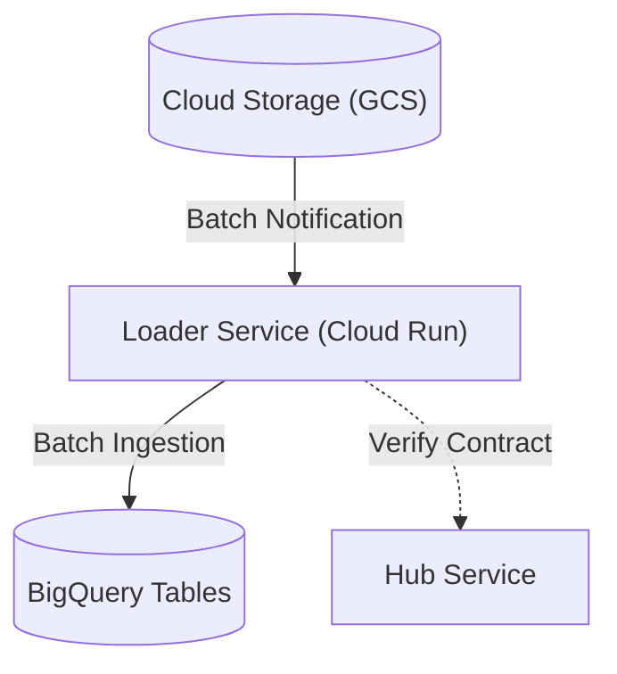

# loader Module

Terraform module for deploying and configuring `loader`.

## Architecture & Data Flow



## Golden Path Usage

```terraform
module "loader" {
  source = "github.com/supercargo-dev/terraform-provider-supercargo//modules/loader"
  bucket_name              = var.bucket_name
  dlq_topic_id             = var.dlq_topic_id
  domain_name              = var.domain_name
  image                    = var.image
  ingress_config           = var.ingress_config
  project_id               = var.project_id
  target_topic_ids         = var.target_topic_ids
}
```

## Configuration Variables

| Variable | Type | Default | Sensitive | Description |
| :--- | :--- | :--- | :--- | :--- |
| `allowed_gcs_buckets` | `string` | `""` | no | Comma-separated list of allowed GCS bucket names for ingestion |
| `bucket_name` | `string` | *required* | no | Source GCS Bucket Name |
| `dlq_topic_id` | `string` | *required* | no | Pub/Sub Topic ID for Dead Letter Queue |
| `domain_name` | `string` | *required* | no | Data Domain Name (e.g. finance, marketing) |
| `image` | `string` | *required* | no | Container Image URL |
| `ingress_config` | `string` | *required* | no | JSON Configuration for the Ingress Service |
| `ingress_type` | `string` | `"INGRESS_TRAFFIC_INTERNAL_ONLY"` | no | The type of ingress traffic allowed (INGRESS_TRAFFIC_ALL or INGRESS_TRAFFIC_INTERNAL_ONLY or INGRESS_TRAFFIC_INTERNAL_AND_GCLB) |
| `max_instances` | `number` | `3` | no | The maximum number of instances for the Loader service |
| `project_id` | `string` | *required* | no | GCP Project ID |
| `region` | `string` | `"europe-west1"` | no | GCP Region |
| `target_topic_ids` | `list(string)` | *required* | no | List of Target Pub/Sub Topic IDs to grant publish permissions on |

## Module Outputs

| Output | Sensitive | Description |
| :--- | :--- | :--- |
| `service_account_email` | no | The service account email for the Loader |
| `service_url` | no | The URL of the Loader service |

## Implementation
- Source Code: `modules/loader`
