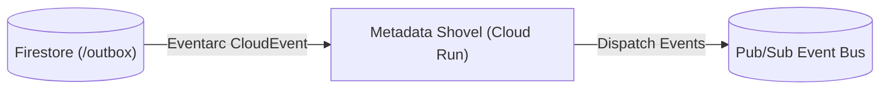

# metadata_shovel Module

Terraform module for deploying and configuring `metadata_shovel`.

## Architecture & Data Flow



## Golden Path Usage

```terraform
module "metadata_shovel" {
  source = "github.com/supercargo-dev/terraform-provider-supercargo//modules/metadata_shovel"
  default_topic_id         = var.default_topic_id
  image                    = var.image
  project_id               = var.project_id
  region                   = var.region
}
```

## Configuration Variables

| Variable | Type | Default | Sensitive | Description |
| :--- | :--- | :--- | :--- | :--- |
| `default_topic_id` | `string` | *required* | no | Default Pub/Sub Topic ID (resource id) |
| `firestore_database` | `string` | `"(default)"` | no | Firestore Database ID |
| `image` | `string` | *required* | no | Container Image URL |
| `ingress_type` | `string` | `"INGRESS_TRAFFIC_INTERNAL_ONLY"` | no | The type of ingress traffic allowed (INGRESS_TRAFFIC_ALL or INGRESS_TRAFFIC_INTERNAL_ONLY or INGRESS_TRAFFIC_INTERNAL_AND_GCLB) |
| `project_id` | `string` | *required* | no | GCP Project ID |
| `region` | `string` | *required* | no | GCP Region |
| `service_name` | `string` | `"metadata-shovel-internal"` | no | Cloud Run Service Name |
| `topic_routing` | `map(string)` | `{}` | no | Map of URN Prefix to Pub/Sub Topic ID |

## Module Outputs

| Output | Sensitive | Description |
| :--- | :--- | :--- |
| `service_account_email` | no | - |
| `service_url` | no | - |

## Implementation
- Source Code: `modules/metadata_shovel`
