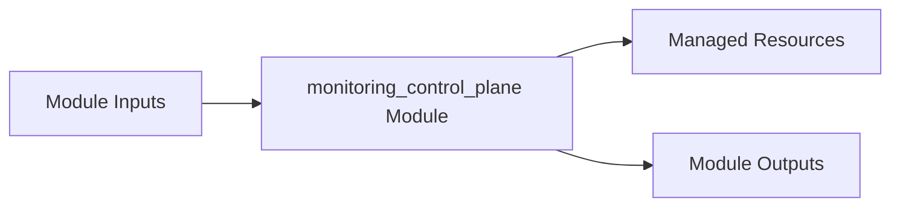

# monitoring_control_plane Module

Terraform module for deploying and configuring `monitoring_control_plane`.

## Architecture & Data Flow



## Golden Path Usage

```terraform
module "monitoring_control_plane" {
  source = "github.com/supercargo-dev/terraform-provider-supercargo//modules/monitoring_control_plane"
  project_id               = var.project_id
}
```

## Configuration Variables

| Variable | Type | Default | Sensitive | Description |
| :--- | :--- | :--- | :--- | :--- |
| `additional_sre_notification_channels` | `list(string)` | `[]` | no | Additional notification channels for SRE operations (webhooks, email) |
| `alert_email_address` | `string` | `""` | no | Email notification address for alerts |
| `alert_notification_channels` | `list(string)` | `[]` | no | List of Cloud Monitoring notification channel IDs for alert routing |
| `alert_pagerduty_service_key` | `string` | (sensitive) | yes | PagerDuty integration service key for Tier 1 paging |
| `alert_slack_channel` | `string` | `""` | no | Slack notification channel name (e.g. #supercargo-sre) |
| `analytics_dashboard_max_instances` | `number` | `5` | no | Max instances configured for Analytics Dashboard Cloud Run service |
| `analytics_dashboard_service_name` | `string` | `"analytics-dashboard"` | no | Cloud Run service name for Analytics Dashboard |
| `analytics_runner_job_name` | `string` | `"analytics-runner"` | no | Cloud Run Job name for Analytics Runner |
| `console_max_instances` | `number` | `5` | no | Max instances configured for Console Cloud Run service |
| `console_service_name` | `string` | `"console"` | no | Cloud Run service name for Supercargo Console |
| `dataform_events_dlq_subscription_name` | `string` | `"dataform-events-dlq-sub"` | no | Pub/Sub pull subscription name for Dataform DLQ inspection |
| `dataform_events_push_subscription_name` | `string` | `"hub-dataform-events-push"` | no | Pub/Sub subscription name for Dataform events push |
| `enable_control_plane_alerts` | `bool` | `true` | no | Whether to provision Cloud Monitoring alert policies for control plane services and pipelines |
| `enable_dashboards` | `bool` | `true` | no | Whether to provision the turnkey persona dashboards |
| `enable_slos` | `bool` | `true` | no | Whether to provision Custom Services, SLOs, and burn-rate alert policies |
| `environment` | `string` | `"dev"` | no | The deployment environment (dev, staging, prod) |
| `events_push_subscription_name` | `string` | `"hub-events-push"` | no | Pub/Sub subscription name for hub events push |
| `firestore_database_id` | `string` | `"(default)"` | no | Firestore database ID |
| `github_runner_job_name` | `string` | `"github-runner-job"` | no | Cloud Run Job name for GitHub Self-Hosted Runner |
| `github_runner_webhook_max_instances` | `number` | `5` | no | Max instances configured for GitHub Runner Webhook Cloud Run service |
| `github_runner_webhook_service_name` | `string` | `"github-runner-webhook"` | no | Cloud Run service name for GitHub Runner Webhook |
| `github_sync_job_names` | `list(string)` | `[
    "analytics-github-sync-repositories",
    "analytics-github-sync-issues",
    "analytics-github-sync-pulls",
    "analytics-github-sync-workflow-runs",
    "analytics-github-sync-billing",
  ]` | no | List of Cloud Run Job names for GitHub metadata sync |
| `health_events_subscription_name` | `string` | `"supercargo-health-events-bq"` | no | Pub/Sub subscription name for health events BigQuery sink |
| `hub_max_instances` | `number` | `10` | no | Max instances configured for Hub Cloud Run service |
| `hub_service_name` | `string` | `"hub"` | no | Cloud Run service name for Hub |
| `kms_crypto_key_name` | `string` | `"supercargo-vault-master-key"` | no | Cloud KMS crypto key name for Vault master encryption |
| `kms_key_ring_name` | `string` | `"supercargo-keyring"` | no | Cloud KMS keyring name for Vault master encryption |
| `mcp_max_instances` | `number` | `5` | no | Max instances configured for Supercargo MCP Cloud Run service |
| `mcp_service_name` | `string` | `"supercargo-mcp"` | no | Cloud Run service name for Supercargo MCP |
| `monitored_batch_jobs` | `list(string)` | `null` | no | Optional explicit list of Cloud Run Job names to monitor. If null, derived from individual job name variables. |
| `name_suffix` | `string` | `""` | no | Optional name suffix for multi-tenant or ephemeral isolation |
| `outbox_audit_subscription_name` | `string` | `"supercargo-audit-bq"` | no | Pub/Sub subscription name for outbox audit BigQuery sink (resolves #300) |
| `project_id` | `string` | *required* | no | The GCP project ID where the Control Plane resources reside |
| `region` | `string` | `"europe-west1"` | no | The GCP region where Cloud Run services and jobs are deployed |
| `scheduler_job_names` | `list(string)` | `[
    "analytics-runner-schedule",
    "analytics-github-sync-repositories-schedule",
    "analytics-github-sync-issues-schedule",
    "analytics-github-sync-pulls-schedule",
    "analytics-github-sync-workflow-runs-schedule",
    "analytics-github-sync-billing-schedule",
  ]` | no | List of Cloud Scheduler job names for control plane triggers |
| `shovel_max_instances` | `number` | `5` | no | Max instances configured for Metadata Shovel Cloud Run service |
| `shovel_service_name` | `string` | `"metadata-shovel"` | no | Cloud Run service name for Metadata Shovel |
| `shovel_trigger_name` | `string` | `"shovel-trigger"` | no | Eventarc trigger name for Firestore /outbox events |
| `sla_tier` | `string` | `"TIER_1"` | no | The SLA tier for the control plane (TIER_1, TIER_2, TIER_3). Calibrates alert thresholds and paging severity. |
| `telemetry_dlq_subscription_name` | `string` | `"supercargo-telemetry-dlq"` | no | Pub/Sub subscription name for platform telemetry DLQ |
| `telemetry_subscriptions` | `list(string)` | `[
    "bigquery-hub-operations",
    "bigquery-vault-operations",
    "bigquery-gateway-executions",
    "bigquery-mcp-interactions",
    "bigquery-sentinel-interventions",
    "bigquery-platform-telemetry",
    "bigquery-flusher-heartbeat",
  ]` | no | List of operational telemetry BigQuery streaming subscriptions monitored for lag |
| `unacked_message_age_threshold_seconds` | `number` | `null` | no | Optional override for Pub/Sub unacknowledged message age alert threshold. If unset, derived from sla_tier. |
| `vault_max_instances` | `number` | `10` | no | Max instances configured for Vault Cloud Run service |
| `vault_service_name` | `string` | `"vault"` | no | Cloud Run service name for Vault |

## Module Outputs

| Output | Sensitive | Description |
| :--- | :--- | :--- |
| `all_alert_notification_channels` | no | Aggregated list of all alert notification channels including PagerDuty (suppressed on TIER_3) |
| `dashboard_governance_id` | no | Resource ID of the Governance & Privacy Plane dashboard |
| `dashboard_governance_url` | no | Direct GCP Console URL for the Governance & Privacy Plane dashboard |
| `dashboard_sre_id` | no | Resource ID of the Control Plane SRE Infrastructure dashboard |
| `dashboard_sre_url` | no | Direct GCP Console URL for the Control Plane SRE Infrastructure dashboard |
| `hub_availability_slo_id` | no | Resource ID of the Hub availability SLO |
| `hub_custom_service_id` | no | Custom service ID for Supercargo Hub |
| `hub_latency_slo_id` | no | Resource ID of the Hub latency SLO |
| `tier2_alert_notification_channels` | no | Aggregated list of non-paging alert notification channels (excluding PagerDuty) |
| `unacked_message_age_threshold_seconds` | no | The active unacknowledged message age threshold in seconds derived from SLA tier |
| `vault_availability_slo_id` | no | Resource ID of the Vault availability SLO |
| `vault_custom_service_id` | no | Custom service ID for Supercargo Vault |
| `vault_latency_slo_id` | no | Resource ID of the Vault latency SLO |

## Implementation
- Source Code: `modules/monitoring_control_plane`
