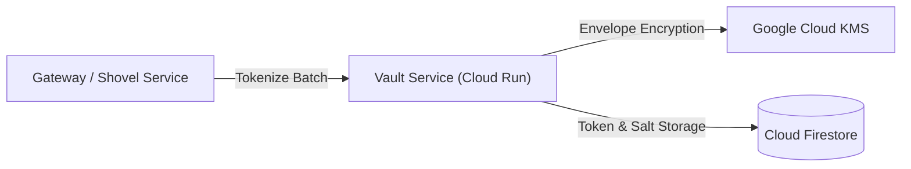

# security_vault Module

Terraform module for deploying and configuring `security_vault`.

## Architecture & Data Flow



## Golden Path Usage

```terraform
module "security_vault" {
  source = "github.com/supercargo-dev/terraform-provider-supercargo//modules/security_vault"
  env                      = var.env
  platform_topic_id        = var.platform_topic_id
  project_id               = var.project_id
  sovereign_kms_key_id     = var.sovereign_kms_key_id
}
```

## Configuration Variables

| Variable | Type | Default | Sensitive | Description |
| :--- | :--- | :--- | :--- | :--- |
| `authorized_view_sa_email` | `string` | `""` | no | The email of the service account authorized to view the data. |
| `bigquery_deletion_protection` | `bool` | `true` | no | Whether to enable deletion protection on BigQuery tables |
| `env` | `string` | *required* | no | The environment name. |
| `location` | `string` | `"EU"` | no | The GCP location for the dataset. |
| `platform_topic_id` | `string` | *required* | no | The Pub/Sub topic ID for the platform events (raw-platform). |
| `project_id` | `string` | *required* | no | The GCP project ID where the security vault will be created. |
| `sovereign_kms_key_id` | `string` | *required* | no | The fully qualified ID of the KMS key used for sovereign encryption. |

## Module Outputs

No module outputs defined.

## Implementation
- Source Code: `modules/security_vault`
