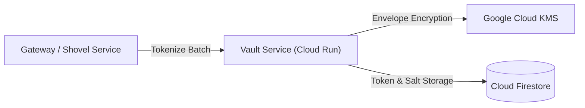

# vault Module

Terraform module for deploying and configuring `vault`.

## Architecture & Data Flow



## Golden Path Usage

```terraform
module "vault" {
  source = "github.com/supercargo-dev/terraform-provider-supercargo//modules/vault"
  gateway_service_account_email = var.gateway_service_account_email
  image                    = var.image
  project_id               = var.project_id
  project_number           = var.project_number
}
```

## Configuration Variables

| Variable | Type | Default | Sensitive | Description |
| :--- | :--- | :--- | :--- | :--- |
| `auth_enforce` | `bool` | `true` | no | Whether to enforce OIDC authentication (Shadow Mode if false) |
| `authorized_invokers` | `list(string)` | `[]` | no | List of IAM members authorized to invoke the vault directly |
| `authorized_tokenizer_sa` | `string` | `""` | no | Authorized tokenizer service account email |
| `crypto_key_name` | `string` | `"supercargo-vault-master-key"` | no | The name of the Cloud KMS CryptoKey for the Vault master key. Defaults to 'supercargo-vault-master-key'. |
| `custom_audiences` | `list(string)` | `[]` | no | List of custom audiences to accept for OIDC |
| `force_deploy_trigger` | `string` | `"static"` | no | A value that, when changed, triggers a new Cloud Run revision (e.g. git SHA or image digest). Use 'latest' or a fixed value for idempotency. |
| `gateway_service_account_email` | `string` | *required* | no | The service account email of the Ingestion Gateway |
| `iap_allowed_members` | `list(string)` | `[]` | no | List of members to grant IAP access to |
| `iap_client_id` | `string` | `""` | no | The OAuth 2.0 Client ID for IAP (manually created) |
| `iap_enabled` | `bool` | `false` | no | Whether to enable IAP for the service |
| `image` | `string` | *required* | no | The container image to deploy |
| `ingress_type` | `string` | `"INGRESS_TRAFFIC_INTERNAL_ONLY"` | no | The ingress type for the Cloud Run service |
| `key_rotation_period` | `string` | `"2592000s"` | no | The rotation period for the Cloud KMS master key (e.g. '2592000s' for 30 days). |
| `keyring_name` | `string` | `"supercargo-vault-keyring"` | no | The name of the Cloud KMS KeyRing for the Vault. Defaults to 'supercargo-vault-keyring' (stable naming without random suffixes to prevent recreation of immutable KMS resources). |
| `max_instances` | `number` | `3` | no | The maximum number of instances for the Vault service |
| `name_suffix` | `string` | `""` | no | Optional deterministic suffix appended to resource names for environment/branch disambiguation. Defaults to empty. |
| `oidc_audience` | `string` | `""` | no | The expected audience for OIDC tokens |
| `project_id` | `string` | *required* | no | The GCP project ID |
| `project_number` | `string` | *required* | no | The GCP Project Number |
| `region` | `string` | `"europe-west1"` | no | The GCP region |
| `service_name` | `string` | `"vault"` | no | The name of the Cloud Run service |
| `telemetry_identity_salt` | `string` | `"supercargo-default-salt"` | no | Identity salt for vault operational telemetry hashing |
| `telemetry_topic_id` | `string` | `"supercargo-platform-telemetry"` | no | Target Pub/Sub topic ID for vault operational telemetry |

## Module Outputs

| Output | Sensitive | Description |
| :--- | :--- | :--- |
| `iap_client_id` | no | - |
| `master_key_id` | no | - |
| `service_account_email` | no | - |
| `service_name` | no | - |
| `service_url` | no | - |
| `vault_service_account_email` | no | - |

## Implementation
- Source Code: `modules/vault`
