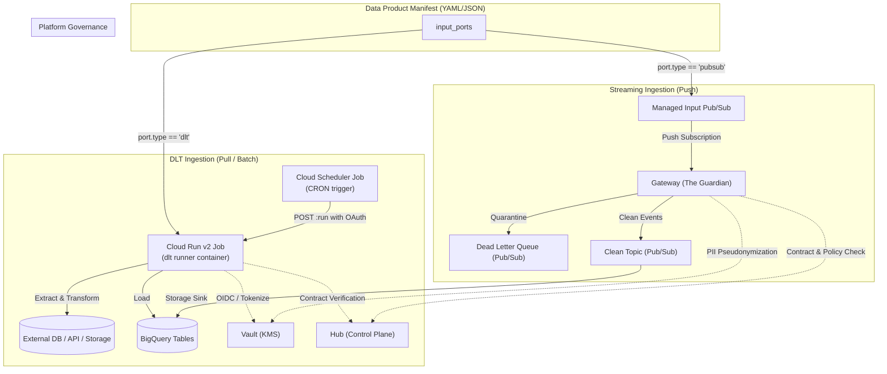

# Data Product Terraform Module (`data_product`)

Turnkey Terraform module provisioning an end-to-end Supercargo Data Product, including declarative Pub/Sub streaming ingress (Guardian Gateway), declarative DLT batch/micro-batch ingestion (Cloud Run v2 Jobs & Cloud Scheduler), DLQ alerting, and contract registration.

## Architecture



### Ingress Planes
1. **Streaming Push (Guardian Gateway)**: For real-time event streaming (`pubsub` type input ports). Publishes events through Pub/Sub push subscriptions to the Gateway Cloud Run service for schema validation and PII pseudonymization.
2. **Declarative DLT Ingestion (Batch/Scheduled)**: For batch sources (`dlt://sql_database`, `dlt://rest_api`, `dlt://filesystem`, `dlt://custom`). Provisions dedicated Cloud Run v2 Jobs and Cloud Scheduler triggers configured with least-privilege IAM roles (`roles/run.invoker`, `roles/bigquery.dataEditor`, `roles/bigquery.jobUser`, `roles/secretmanager.secretAccessor`).

## Golden Path Usage

```hcl
module "data_product" {
  source = "github.com/supercargo-dev/terraform-provider-supercargo//modules/data_product"

  project_id    = "my-gcp-project"
  region        = "europe-west1"
  manifest_file = "${path.module}/supercargo.manifest.yaml"

  hub_address   = "https://hub.internal.supercargo.net"
  kms_address   = "https://vault.internal.supercargo.net"
  master_key_uri = "gcp-kms://projects/my-gcp-project/locations/europe-west1/keyRings/supercargo/cryptoKeys/master-key"
  image         = "ghcr.io/supercargo-dev/supercargo-gateway:latest"

  # Optional DLT Ingress Configurations
  dlt_runner_image        = "ghcr.io/supercargo-dev/supercargo-dlt-runner:latest"
  dlt_deletion_protection = true
  dlt_time_zone           = "UTC"
}
```

## Operational Backfills

Each configured DLT input port exports a pre-rendered, turn-key `gcloud` backfill command in module output `dlt_backfill_commands`.

To execute an ad-hoc historical backfill or run an immediate catch-up sync:

```bash
# 1. Inspect generated backfill commands from Terraform output:
terraform output dlt_backfill_commands

# 2. Run the backfill command with desired historical timestamp:
gcloud run jobs execute <job-name> \
  --region europe-west1 \
  --project my-gcp-project \
  --args="--since=2026-01-01T00:00:00Z"
```

## Inputs

| Name | Description | Type | Default | Required |
|------|-------------|------|---------|:--------:|
| `manifest_file` | Path to the Data Product manifest YAML/JSON file | `string` | n/a | yes |
| `project_id` | The GCP project ID | `string` | n/a | yes |
| `region` | The GCP region | `string` | n/a | yes |
| `image` | The container image for The Guardian service | `string` | n/a | yes |
| `hub_address` | The address of the Hub service | `string` | n/a | yes |
| `kms_address` | The address of the KMS (Vault) service | `string` | n/a | yes |
| `master_key_uri` | The URI of the Master Key in GCP KMS | `string` | n/a | yes |
| `contracts` | Map of contracts to register and provision | `map(object)` | `{}` | no |
| `log_level` | Log level for the service | `string` | `"info"` | no |
| `container_memory` | The memory limit for the container | `string` | `"512Mi"` | no |
| `container_cpu` | The CPU limit for the container | `string` | `"1"` | no |
| `bigquery_dataset_id` | The BigQuery dataset ID where tables should be created | `string` | `""` | no |
| `bigquery_deletion_protection` | Whether to enable deletion protection on BigQuery tables | `bool` | `true` | no |
| `auth_enforce` | Whether to enforce OIDC authentication (Shadow Mode if false) | `bool` | `true` | no |
| `authorized_invokers` | List of IAM members authorized to invoke the gateway | `list(string)` | `[]` | no |
| `authorized_invoker_service_accounts` | List of service account emails authorized to invoke the gateway service | `list(string)` | `[]` | no |
| `name_suffix` | Optional deterministic suffix appended to resource names | `string` | `""` | no |
| `service_account_id` | Optional custom service account ID for the Gateway | `string` | `""` | no |
| `dlt_runner_image` | The container image for DLT pipeline runners | `string` | `"ghcr.io/supercargo-dev/supercargo-dlt-runner:latest"` | no |
| `dlt_deletion_protection` | Whether to protect DLT Cloud Run v2 Jobs from accidental deletion | `bool` | `false` | no |
| `dlt_time_zone` | Time zone for Cloud Scheduler cron jobs | `string` | `"UTC"` | no |
| `dlt_cpu` | The CPU allocation for DLT Cloud Run jobs | `string` | `"1"` | no |
| `dlt_memory` | The memory limit for DLT Cloud Run jobs | `string` | `"1Gi"` | no |
| `dlt_timeout` | The maximum execution timeout for DLT Cloud Run jobs | `string` | `"3600s"` | no |
| `dlt_max_retries` | The maximum number of retry attempts for failed DLT Cloud Run jobs | `number` | `3` | no |
| `dlt_runner_service_account_id` | Optional custom service account ID for DLT runner Cloud Run jobs | `string` | `""` | no |
| `dlt_scheduler_service_account_id` | Optional custom service account ID for DLT Cloud Scheduler jobs | `string` | `""` | no |
| `dlt_scheduler_attempt_deadline` | The attempt deadline for Cloud Scheduler jobs triggering DLT Cloud Run jobs | `string` | `"320s"` | no |
| `enable_dlq_alerts` | Whether to enable Cloud Monitoring alert policies for DLQ | `bool` | `true` | no |
| `dlq_alert_threshold` | Threshold count of undelivered messages in DLQ to trigger alert | `number` | `0` | no |
| `dlq_unacked_message_age_seconds` | Threshold age (seconds) of oldest unacknowledged DLQ message | `number` | `300` | no |
| `dlq_runbook_url` | Runbook URL for DLQ incident remediation | `string` | `"https://docs.supercargo.dev/operations/runbooks/dlq-remediation"` | no |

## Outputs

| Name | Description | Sensitive |
|------|-------------|:---------:|
| `product_urn` | The URN of the registered Data Product | no |
| `gateway_service_name` | The name of the Gateway Cloud Run service | no |
| `gateway_url` | The URL of the deployed Cloud Run Gateway | no |
| `raw_topic_id` | The ID of the Raw topic | no |
| `clean_topic_id` | The ID of the Clean topic | no |
| `dlq_topic_id` | The ID of the Dead Letter Queue topic | no |
| `push_invoker_service_account_email` | The email of the Pub/Sub Push Invoker Service Account | no |
| `raw_subscription_id` | The ID of the Raw Pub/Sub Push Subscription | no |
| `dlq_subscription_id` | The ID of the Dead Letter Queue Subscription | no |
| `bigquery_table_ids` | A map of contract names to BigQuery table IDs | no |
| `service_account_email` | The service account email of the Gateway | no |
| `service_account_id` | The account ID of the Gateway Service Account | no |
| `contracts` | Map of auto-discovered or explicitly provided contracts | no |
| `managed_input_topics` | Map of managed input port names to their created Pub/Sub topic IDs | no |
| `input_subscription_ids` | Map of input port names to their Pub/Sub push subscription IDs | no |
| `dlq_alert_policy_undelivered_id` | The ID of Cloud Monitoring alert policy for DLQ undelivered messages | no |
| `dlq_alert_policy_age_id` | The ID of Cloud Monitoring alert policy for DLQ oldest unacked message age | no |
| `dlt_cloud_run_job_names` | Map of DLT input port names to their Cloud Run v2 Job names | no |
| `dlt_cloud_scheduler_job_ids` | Map of DLT input port names to their Cloud Scheduler job IDs | no |
| `dlt_backfill_commands` | Ready-to-run gcloud commands for ad-hoc DLT historical backfills | no |
| `dlt_runner_service_account_email` | The email of the DLT Runner Service Account (`null` if no DLT ports declared) | no |
| `dlt_scheduler_service_account_email` | The email of the DLT Cloud Scheduler Service Account (`null` if no DLT ports declared) | no |
